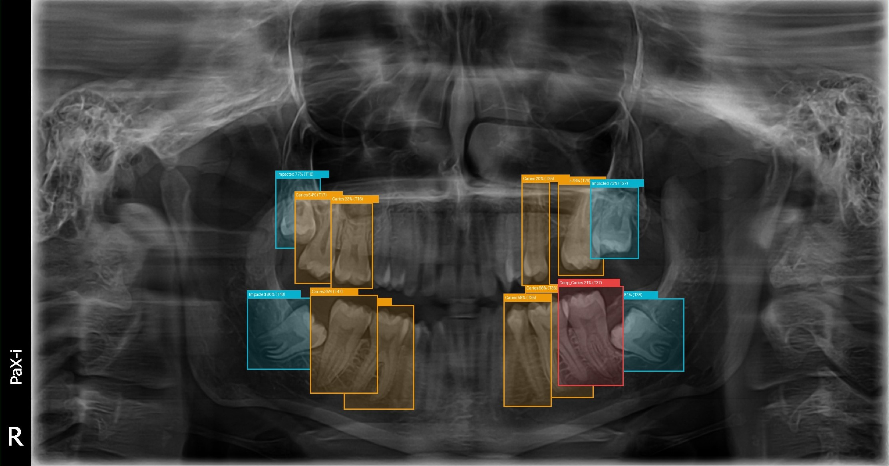
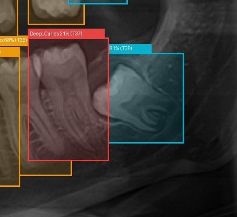
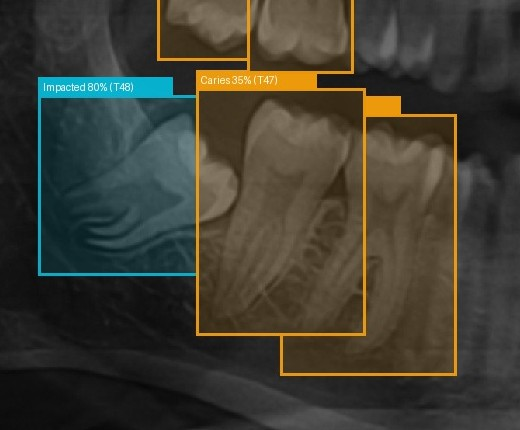
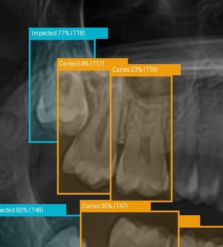
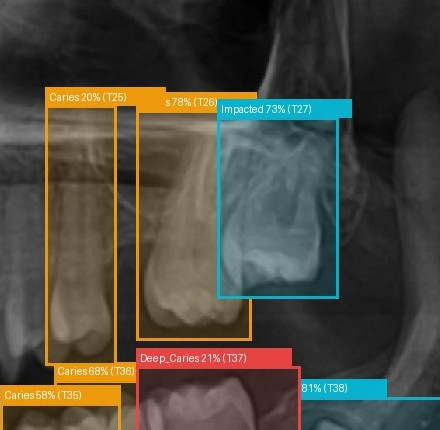
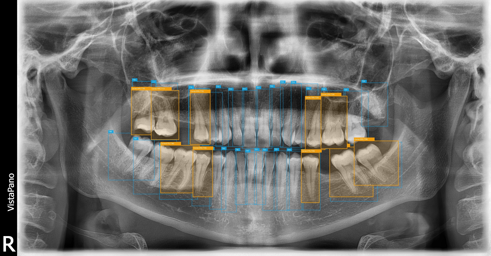
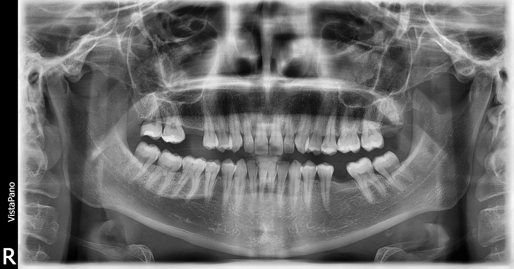
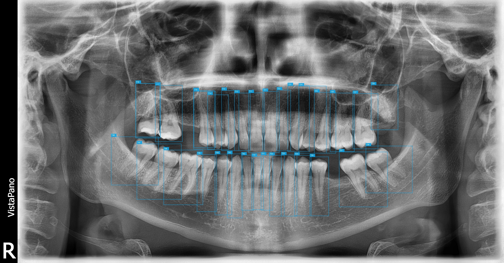

# Doctor Dental — Smart Dental Diagnosis & Tooth Alignment Decision Support System

[](https://fastapi.tiangolo.com)
[](https://pytorch.org)
[](https://ultralytics.com)
[](https://react.dev)
[](https://www.typescriptlang.org)
[](https://tailwindcss.com)
[](https://www.reportlab.com)

**Doctor Dental** is a local-first clinical decision support web application built for healthcare and dental diagnostics. It integrates two specialized deep learning models (`enumeration.pt` and `disease.pt`) to simultaneously localize all 32 adult teeth using FDI standard notation, detect primary dental pathologies, correlate lesions with specific teeth via spatial bounding-box overlap, perform comprehensive 2D geometric tooth alignment & orthodontic screening, and compile diagnostic PDF reports.

<p align="center">
  
</p>
<p align="center">
  <em>Figure 1: Full-panoramic dental disease detection with YOLO11m, showing localized impacted third molars (cyan), deep caries encroaching the pulp chamber (red), and coronal/interproximal caries (orange) spatially associated with FDI tooth numbers.</em>
</p>

---

## 1. System Overview & Core Capabilities

### 🦷 Tooth Enumeration & Odontogram Mapping (`enumeration.pt`)
- **Model Architecture**: **YOLO11m Object Detector** trained on dental panoramic radiographs (OPGs).
- **Class Mapping**: 32 standard adult FDI teeth across 4 anatomical quadrants:
  - **Quadrant 1 (Upper Right)**: `11`, `12`, `13`, `14`, `15`, `16`, `17`, `18`
  - **Quadrant 2 (Upper Left)**: `21`, `22`, `23`, `24`, `25`, `26`, `27`, `28`
  - **Quadrant 3 (Lower Left)**: `31`, `32`, `33`, `34`, `35`, `36`, `37`, `38`
  - **Quadrant 4 (Lower Right)**: `41`, `42`, `43`, `44`, `45`, `46`, `47`, `48`
- Automatically identifies present, missing, impacted, or unerupted teeth.

### 🔬 Dental Disease Detection (`disease.pt` / `disesase.pt`)
- **Model Architecture**: **YOLO11m Object Detector**.
- **Class Mapping (4 Pathologies)**:
  - `0: Impacted` — Tooth angulation or impaction against bone/adjacent tooth structure
  - `1: Caries` — Enamel and superficial-to-moderate dentinal carious demineralization
  - `2: Periapical_Lesion` — Periapical inflammatory radiolucency / apical periodontitis
  - `3: Deep_Caries` — Advanced carious breakdown approaching or encroaching on the pulp chamber

<p align="center">
  
</p>
<p align="center">
  <em>Figure 2: Panoramic disease detection layer displaying multiple localized carious lesions across maxillary and mandibular dentition with confidence percentages and linked FDI tooth identifiers.</em>
</p>

#### 🔍 Pathology Detection Close-Ups & Detailed Lesion Analysis

| **Quadrant 3: Deep Caries (`T37`) & Impacted Wisdom Tooth (`T38`)** | **Quadrant 4: Horizontal Impaction (`T48`) & Caries (`T47`)** |
|:---:|:---:|
|  |  |
| *Severe coronal caries encroaching on the pulp chamber (`T37`, red) accompanied by horizontal third-molar impaction (`T38`, cyan) and adjacent coronal caries (`T36`, `T35`).* | *Severe horizontal impaction of mandibular third molar (`T48`, cyan) wedged against adjacent second molar (`T47`, orange) with coronal demineralization.* |

| **Quadrant 1: Maxillary Caries (`T16`, `T17`) & Impaction (`T18`)** | **Quadrant 2: Maxillary Caries (`T25`, `T26`) & Impaction (`T27`)** |
|:---:|:---:|
|  |  |
| *Occlusal and interproximal carious lesions on first and second molars (`T16`, `T17`) with unerupted impacted third molar (`T18`).* | *Interproximal caries detected on premolar and molar (`T25`, `T26`) alongside angulated impacted third molar (`T27`).* |

### 📐 Spatial Overlap & Anatomical Association Engine
- Computes Intersection over Lesion Area ($\text{IoA} \ge 0.20$) to associate detected lesions directly with their corresponding FDI tooth numbers.
- Incorporates vertical root tolerance to reliably capture periapical lesions extending beyond the anatomical root boundary.

<p align="center">
  
</p>
<p align="center">
  <em>Figure 3: Dual-model fusion visualization — simultaneous 32-tooth FDI enumeration (cyan) and disease pathology detection (orange) demonstrating spatial IoA bounding-box association.</em>
</p>

#### 🔄 Multi-Layer Radiograph Pipeline Breakdown

| 1. Raw OPG Radiograph | 2. FDI Tooth Enumeration Map | 3. YOLO11m Pathology Layer |
|:---:|:---:|:---:|
|  |  |  |
| *Input panoramic radiograph* | *32 anatomical tooth boundaries* | *Isolated pathology detection boxes* |

---

### 📏 Advanced Orthodontic & Tooth Alignment Screening Engine
The alignment analysis module provides a comprehensive 2D geometric assessment based on detected tooth centroids, bounding dimensions, and fitted dental arch curves:

1. **Arch Curve Fitting & Symmetry Analysis**:
   - Separates teeth into maxillary (quadrants 1 & 2) and mandibular (quadrants 3 & 4) arches.
   - Fits a 2nd-degree polynomial curve ($y = ax^2 + bx + c$) for each arch ($\ge 4$ teeth required).
   - Calculates normalized perpendicular deviations against median tooth width to flag teeth with notable arch displacement.
   - Evaluates left/right arch symmetry and focal curve discrepancies.

2. **Arch-Length Discrepancy & Crowding Assessment**:
   - Calculates available arch length using numerical line integration along the fitted arch curve:
     $$\text{Arch Length} = \int_{x_{\min}}^{x_{\max}} \sqrt{1 + \left(\frac{dy}{dx}\right)^2} \, dx$$
   - Sums total mesiodistal tooth widths across detected teeth to compute space discrepancy ($\text{Available} - \text{Required}$).
   - Detects **horizontal bounding box overlaps** between adjacent teeth (`OverlappingPair`), recording overlap pixels, overlap ratios relative to median tooth width, and bounding coordinates for visual overlay.
   - Grades crowding severity into **None**, **Mild**, **Moderate**, or **Severe**.

3. **Interdental Spacing & Midline Diastema Screening**:
   - Evaluates interdental spacing ratios against median tooth widths across both arches.
   - Automated detection and measurement of **Midline Diastema** between central incisors (`11`–`21` for maxillary arch, `31`–`41` for mandibular arch).
   - Generates exact caliper coordinates (`x1`, `x2`, `y`) for on-image radiograph overlay.
   - Identifies generalized interdental spacing and wide gaps.

4. **Tooth Rotation & Coronal Tipping Screening**:
   - Evaluates 2D aspect ratios ($\text{width} / \text{height}$) of each detected tooth against standard dental anatomical morphometric norms (`EXPECTED_ASPECT_RATIOS` for incisors, canines, premolars, and molars).
   - Flags anomalous deviations indicating axial rotation or significant crown tipping (graded as **Mild**, **Moderate**, or **Marked**).
   - Provides coordinate bounding markers for radiograph highlighting.

---

### 🖥️ Doctor Dental Clinical Workspace UI
- **Interactive 4-Tab Alignment & Orthodontic Panel**:
  - **Tab 1: Arch Curve & Symmetry** — Polynomial arch visualization, tooth deviation badges, asymmetry analysis.
  - **Tab 2: Crowding & Space Deficit** — Space discrepancy gauge, available vs. required length, overlap list with hover cross-highlighting.
  - **Tab 3: Interdental Spacing & Diastema** — Midline diastema caliper card with millimeter/pixel gap readouts, wide gap grid.
  - **Tab 4: Tooth Rotation** — Suspected axial twist / tilted crown profiles, measured aspect ratio vs standard reference, deviation percentages.
- **Synchronized Radiograph Canvas**:
  - Full-width 75vh viewer with segmented layer switcher (All Annotations, Teeth Only, Diseases Only, Original Radiograph).
  - Multi-layer SVG overlays synchronized with the odontogram and findings panel.
  - Interactive alignment overlays: arch curve polynomials, overlap indicators, diastema calipers, and rotation markers.
- **Interactive 32-Tooth Odontogram**:
  - Quadrant-filtered interactive dental arch map with color-coded health status, hover tooltips, and card grid.
- **Chairside Follow-Up Guidance**:
  - Accordion layout with severity-colored borders, filter chips (All, Caries, Deep Caries, Impacted, Periapical), and auto-scroll cross-linking from selected teeth.
  - Transparent, non-prescriptive prompts for pulp vitality testing, tactile probing, and margin assessment.
- **Automated Clinical PDF Reporting**:
  - Compiles diagnostic findings, original & annotated radiographs, tooth tables, chairside restoration recommendations, and orthodontic screening summaries into a downloadable PDF report via ReportLab.

---

## 2. Technology Stack

### Backend
- **Python**: 3.10 – 3.14 compatible
- **FastAPI & Uvicorn**: High-performance asynchronous API
- **PyTorch & Ultralytics**: In-process YOLO11m inference (runs 100% on local CPU in ~270 ms)
- **NumPy**: Geometric curve fitting, line integrals, and morphometric analysis
- **OpenCV & Pillow**: Radiograph validation and annotation rendering
- **ReportLab**: Vector PDF diagnostic report generation
- **Pydantic v2**: Strict schema validation

### Frontend
- **React 19 & TypeScript**: Strict component architecture
- **Vite**: Ultra-fast build & HMR tool
- **Tailwind CSS v4**: Modern clinical healthcare design system
- **Lucide React**: Clean medical iconography
- **React Router v7**: Multi-page client-side routing

---

## 3. Repository Structure

```
Dr.dental/
├── backend/
│   ├── enumeration.pt          # Trained YOLO11m tooth enumeration model (32 FDI classes)
│   ├── disesase.pt             # Trained YOLO11m disease model (symlink to disease.pt)
│   ├── disease.pt              # Trained YOLO11m disease model (4 pathology classes)
│   ├── requirements.txt        # Backend dependencies
│   ├── .env.example            # Backend environment configuration
│   ├── samples/                # Sample dental panoramic radiographs for testing
│   ├── app/
│   │   ├── main.py             # FastAPI entry point & CORS configuration
│   │   ├── config.py           # Configuration & path management
│   │   ├── api/
│   │   │   ├── health.py       # GET /api/health
│   │   │   ├── models.py       # GET /api/models/info
│   │   │   └── analysis.py     # POST /api/analyze, GET /api/analysis/{id}, reports
│   │   ├── services/
│   │   │   ├── model_service.py        # Singleton model loader & metadata introspector
│   │   │   ├── enumeration_service.py  # Tooth detection service
│   │   │   ├── disease_service.py      # Disease detection service
│   │   │   ├── association_service.py  # Spatial tooth-lesion overlap engine
│   │   │   ├── alignment_service.py    # Curve fitting, crowding, spacing & rotation screening
│   │   │   ├── image_service.py        # Image validation & clinical overlay rendering
│   │   │   ├── guidance_service.py     # Rule-based restoration prompts
│   │   │   ├── report_service.py       # ReportLab PDF generator (findings + orthodontic summary)
│   │   │   └── analysis_service.py     # Complete orchestration service
│   │   ├── schemas/
│   │   │   └── analysis.py             # Pydantic data models (teeth, pathologies, crowding, spacing, rotations)
│   │   └── storage/
│   │       └── analysis_store.py       # Safe filesystem store (UUIDs, traversal guards)
│   ├── tests/
│   │   ├── test_health_and_models.py
│   │   ├── test_validation.py
│   │   ├── test_alignment_service.py   # 18 unit tests (curve, crowding, diastema, rotations)
│   │   └── test_real_inference_and_report.py
│   └── data/analyses/          # Local storage for scan images and generated reports
├── frontend/
│   ├── package.json
│   ├── vite.config.ts
│   ├── tsconfig.json
│   ├── index.html
│   └── src/
│       ├── main.tsx
│       ├── App.tsx
│       ├── index.css
│       ├── api/
│       │   ├── client.ts       # Centralized typed API client
│       │   └── types.ts        # TypeScript API interfaces
│       ├── types/
│       │   └── api.ts          # Complete type definitions (Crowding, Spacing, Rotations, Findings)
│       ├── components/
│       │   ├── layout/         # Navbar, Footer, AppLayout
│       │   ├── upload/         # UploadDropzone with drag-drop and sliders
│       │   ├── analysis/       # ImageViewer, Odontogram list, AlignmentPanel, ClinicalSummary, Findings, Guidance
│       │   └── common/         # Disclaimer, LoadingState, ErrorState
│       └── pages/
│           ├── HomePage.tsx     # Hero banner, feature highlights, and simulated panoramic radiograph
│           ├── AnalyzePage.tsx  # Interactive upload workspace
│           ├── ResultsPage.tsx  # Full clinical diagnostic workspace
│           ├── HowItWorksPage.tsx
│           ├── AboutPage.tsx
│           └── NotFoundPage.tsx
├── docs/
│   └── images/                 # Multi-class disease detection, pathology callouts & visual overlays
├── start_backend.ps1           # Windows PowerShell backend start script
├── start_frontend.ps1          # Windows PowerShell frontend start script
├── start_backend.sh            # macOS/Linux backend start script
├── start_frontend.sh           # macOS/Linux frontend start script
├── .gitignore
└── README.md
```

---

## 4. Quick Start Guide

### Option A: Windows PowerShell (Recommended)

1. **Start the Backend**:
   ```powershell
   .\start_backend.ps1
   ```
   *This automatically sets up `backend\.venv`, installs `requirements.txt`, loads the models, and starts Uvicorn at `http://localhost:8005`.*

2. **Start the Frontend** (in a second terminal):
   ```powershell
   .\start_frontend.ps1
   ```
   *This installs node dependencies and starts the Vite development server at `http://localhost:5175`.*

3. Open your browser and navigate to:
   - **Frontend UI**: [http://localhost:5175](http://localhost:5175)
   - **FastAPI Swagger Docs**: [http://localhost:8005/docs](http://localhost:8005/docs)
   - **Health Endpoint**: [http://localhost:8005/api/health](http://localhost:8005/api/health)

---

### Option B: macOS / Linux (Terminal)

1. **Set Up & Start Backend**:
   ```bash
   chmod +x start_backend.sh start_frontend.sh
   ./start_backend.sh
   ```
   *(Or manually:)*
   ```bash
   cd backend
   python3 -m venv .venv
   source .venv/bin/activate
   pip install -r requirements.txt
   cd ..
   export PYTHONPATH=.
   uvicorn backend.app.main:app --host 0.0.0.0 --port 8005 --reload
   ```

2. **Set Up & Start Frontend** (in a separate terminal):
   ```bash
   ./start_frontend.sh
   ```
   *(Or manually:)*
   ```bash
   cd frontend
   npm install
   npm run dev -- --host --port 5175
   ```

3. Open **`http://localhost:5175`** in your browser.

---

## 5. Automated Tests & Quality Assurance

### Backend Unit & Integration Tests
To run the alignment and orthodontic screening test suite:
```bash
# Windows
backend\.venv\Scripts\pytest backend/tests/test_alignment_service.py -v

# macOS / Linux
PYTHONPATH=. backend/.venv/bin/pytest backend/tests/test_alignment_service.py -v
```

**Alignment Test Suite Highlights (`test_alignment_service.py` — 18 tests)**:
- `TestInsufficientData`: Verifies handling when fewer than minimum teeth ($\ge 4$) are detected.
- `TestArchGrouping`: Confirms maxillary and mandibular tooth segregation across all four FDI quadrants.
- `TestDeviationCalculation`: Tests polynomial curve fitting and vertical deviation detection against known geometries.
- `TestSpacingAnalysis`: Verifies interdental spacing ratios and wide-gap identification.
- `TestCrowdingAnalysis`: Validates arch-length space discrepancy calculations and overlapping bounding-box detection.
- `TestMidlineDiastemaAndSpacing`: Verifies automatic diastema detection between central incisors (`11`–`21`).
- `TestRotationScreening`: Verifies aspect-ratio morphometric evaluation and axial rotation flags for abnormal coronal profiles.
- `TestLimitationNotice`: Ensures clinical limitation disclosures are present on all generated outputs.

### Frontend Production Build
To validate TypeScript types and generate production bundles:
```bash
cd frontend && npm run build
```

---

## 6. API Reference

| Method | Endpoint | Description |
|---|---|---|
| `GET` | `/api/health` | Returns application status, compute device (`cpu`/`cuda`), and model readiness |
| `GET` | `/api/models/info` | Returns discovered architectures, 32 FDI tooth classes, and 4 pathology classes |
| `POST` | `/api/analyze` | Accepts multipart image upload, executes dual-model inference + alignment screening, returns complete analysis |
| `GET` | `/api/analysis/{id}` | Retrieves previously computed analysis results by UUID |
| `GET` | `/api/analysis/{id}/image/original` | Serves original uploaded radiograph |
| `GET` | `/api/analysis/{id}/image/annotated` | Serves clinical multi-layer annotated image |
| `GET` | `/api/analysis/{id}/image/teeth_only` | Serves teeth enumeration visualization layer |
| `GET` | `/api/analysis/{id}/image/diseases_only` | Serves disease lesion visualization layer |
| `GET` | `/api/analysis/{id}/report` | Generates and streams downloadable ReportLab PDF diagnostic report with orthodontic summary |

---

## 7. Medical Prototype Notice & Clinical Limitations

1. **Intended Use**: Doctor Dental is an assistive decision-support prototype built for educational, research, and chairside evaluation assistance.
2. **2D Radiographic Limitations**: Alignment, crowding, spacing, and rotation analyses are 2D geometric approximations based on panoramic radiograph projections. They do not replace 3D digital study models, cephalometric tracings, or intraoral physical examination.
3. **Probabilistic Outputs**: Neural network detections represent statistical confidence bounds and do not establish definitive clinical certainty.
4. **No Automatic Prescriptions**: The system does not prescribe extractions, restorations, orthodontics, or surgical procedures.
5. **Professional Responsibility**: All radiographic findings and alignment indicators must be independently reviewed and verified by a licensed dental professional through clinical examination, tactile probing, vitality testing, and comprehensive patient history.
